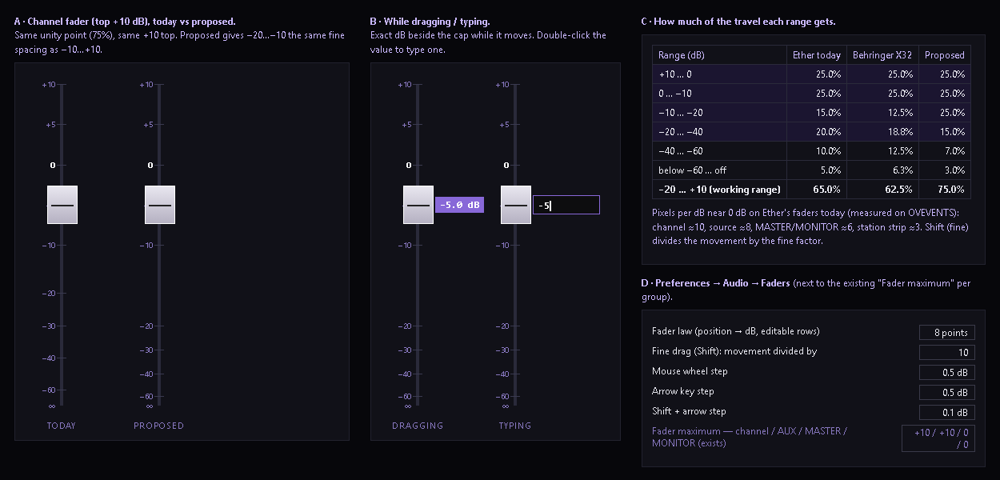

# Fader handling — grab without jumping, a finer law, fine control (PLAN, nothing built) — 2026-10-13

## Jeff (verbatim)

> Fader handling on the board (every fader: channels, MASTER, MONITOR, station faders, and the Park page fader):
> 1. Grab without jumping: clicking the fader cap must never move it. The fader moves only by the distance the mouse moves after grabbing (relative drag), like a real console. Clicking the track (not the cap) must not jump it either.
> 2. Resolution: Jeff can't set −5 dB; the usable travel is too compressed. Research the fader law pro consoles use (e.g. most of the travel spent between −20 and +10, the range below −40 down to off compressed at the bottom), don't guess. Propose a law that gives fine control in the working range. The scale and travel are visible settings, nothing in code.
> 3. Fine control: Shift+drag = fine (slow) movement; mouse wheel steps in 0.5 dB; double-click the value to type an exact number; arrow keys step when the fader is focused. Step sizes are settings.
> 4. Show the exact dB on every fader while dragging.
> Show me a mock and the proposed law before building. Plain words.

## What happens today (source read + OVEVENTS screenshot 09:54)

- **The jump.** Channel/source faders (`ConsoleStrip.tsx` handlePointerDown) and MASTER/MONITOR (`MasterOutput.tsx`
  Fader) set the level from WHERE the pointer is, measured to the cap's centre: grab an 80 px cap near its edge and it
  jumps up to ~40 px (~4 dB) before you move. The station strips and AUX rows are the browser's own slider
  (`<input type=range>`), which jumps to wherever the track is clicked. The Park page fader sets the level where the
  finger lands.
- **The law** (`src/lib/faderLaw.ts`) already gives −10…+10 dB half the travel — the same as the Behringer X32's
  documented law. What is short is the on-screen LENGTH: pixels per dB near 0 dB, measured on OVEVENTS: channel ≈10
  (407 px of travel — about a 100 mm console fader), source ≈8, MASTER/MONITOR ≈6, the station strips ≈3. So −5 dB on
  a station strip is ~1 pixel wide, and the jump on grab makes it worse on every fader.
- No Shift-fine, no wheel, no arrow keys, no typing a value. The channel caps show dB on the cap; MASTER/MONITOR and
  the strips show it beside the fader.

## Research (sources)

- Unity sits about 75 % of the way up on a console fader; near unity a small movement is a fraction of a dB, near the
  bottom the same movement is several dB; professional faders are 104 mm (Sound On Sound,
  https://www.soundonsound.com/sound-advice/q-are-all-faders-created-equal).
- Behringer X32 fader law, four straight-in-dB pieces: off…−60 = 0–6.25 %, −60…−30 = 6.25–25 %, −30…−10 = 25–50 %,
  −10…+10 = 50–100 % (X32 OSC protocol, as quoted at
  https://openstagecontrol.discourse.group/t/mapping-float-value-to-frequency-hz-or-db/1249).
- Many consoles give channels +10 dB above unity and masters 0 dB (Sound On Sound, above); control-surface faders use
  a custom taper that expands −10…+10 (https://forum.midibox.org/t/lc-different-positions-of-0db-in-different-daws/8716).

## Proposed law

Same unity (75 %), same +10 top for channels, same "MASTER/MONITOR top at 0 dB" (the curve slides, as today). The
change: −20…−10 gets the same fine spacing as −10…+10; below −40 is squeezed to the bottom.

| travel | 0 % | 3 % | 10 % | 17.5 % | 25 % | 50 % | 75 % | 100 % |
|---|---|---|---|---|---|---|---|---|
| channel (top +10) | off | −60 | −40 | −30 | −20 | −10 | 0 | +10 |
| MASTER/MONITOR (top 0) | off | −70 | −50 | −40 | −30 | −20 | −10 | 0 |

−20…+10 gets 75 % of the travel (today 65 %, X32 62.5 %). Every dB from −20 to +10 is the same width, 2.5 % of the
travel. Stored levels are gain, so no saved level changes; only where a fader is DRAWN changes below −10.

Honest limit: the law alone does not make the station strips fine (≈3 px/dB). Fine drag, the wheel, arrows and typing
do. Making the station strips longer is a layout change — not proposed unless Jeff asks.

## Proposed handling (every fader: channel, source, MASTER, MONITOR, station strips, AUX rows, Park page)

1. **Grab, no jump.** Pressing on the cap or anywhere on the track changes nothing. Dragging moves the fader by exactly
   the distance moved (relative), from where it was. Touch on the Park page the same.
2. **Shift + drag** = fine: movement divided by the fine factor.
3. **Wheel** = one step per notch; **arrow keys** step when the fader has focus; **Shift + arrow** = fine step.
4. **Double-click the value** → type an exact dB, Enter applies, Esc cancels; above the group's maximum it stops at the
   maximum and says so.
5. **Exact dB beside the cap while dragging**, on every fader (0.1 dB).

## Settings (Preferences → Audio → Faders, next to the existing "Fader maximum" per group)

- Fader law: the position → dB points (the table above), editable rows.
- Fine drag factor; wheel step; arrow step; Shift + arrow step.

**For Jeff to decide:** the starting values (the mock shows: law above, fine ÷10, wheel 0.5 dB, arrow 0.5 dB,
Shift+arrow 0.1 dB). Same pattern as the ducker: written into Preferences once, visible and editable there, never a
number left in code.
