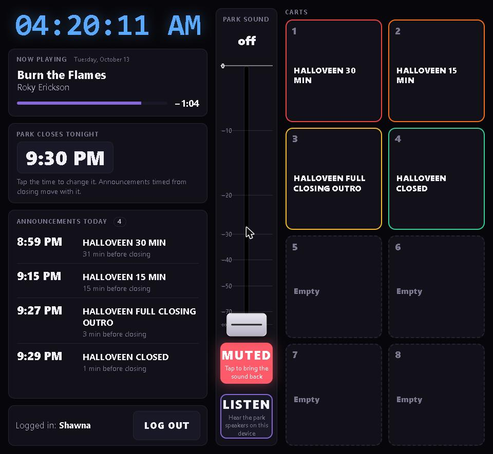

# Park page "Listen" — plan for approval (2026-10-13)

Jeff, verbatim: "add the local audio feed so logged-in staff can hear what the park hears. The feed is exactly what goes to the park speakers: the station's MONITOR output, after the park fader and MUTE. Staff must hear their fader moves, mute and carts. Low delay (aim for about 1 second) … don't guess. Tell me the delay you actually measure … Show me where the button goes … tell me what it needs on OVEVENTS (new station build?) and on the server, before deploying or building an installer."

Nothing is built. This is the plan.

## Where the button goes



- Middle column, directly under MUTE, as the same size of button, in the purple accent.
- Off: "LISTEN — Hear the park speakers on this device". On: "LISTENING".
- Logged-in staff only; never starts by itself.
- The screenshot is the live page with the button drawn in the browser only, not deployed. The page showed MUTED at the time; that was the real state.

## What Ether has today (code read, no change)

- **The park's level is applied at the very end**, just before the speakers: `monitor_vol × master_monitor_vol`, ramped (`native/src/audio.rs:5076-5077`, `native/src/localout.rs:36-38`).
  - The stream is taken earlier (`audio.rs:4879-4885`), so nothing on the monitor side touches what airs.
- **No copy of the after-fader, after-MUTE audio exists to send anywhere.** It only exists inside the speaker write (`localout::write_device`) and the AUX-device ring (`LocalRing::push`).
- **Carts:** carts are "Source" channels.
  - They reach a local output only through the AUX ring, at the MONITOR level (`audio.rs:5067-5082`). They are kept out of the main speaker mix (`audio.rs:4902-4908`).
  - So "what the park hears" = the main MONITOR device feed **plus** the AUX device feed, if both are wired to the park.
  - **Question for Jeff:** which output(s) on OVEVENTS feed the park speakers?
- **The stream already uses a safe pattern:**
  - The audio callback copies into a ring only with `try_push`, and drops when full; it never waits (`audio.rs:4879-4885`).
  - A separate thread serves it on `127.0.0.1` (`audio.rs:5140-5178`).
  - The daemon starts ffmpeg on that port (`audiod/stream.js:76-87`).
- **No WebRTC listen feature exists.** The only WebRTC is the Show+ guest call (`ShowPlus.tsx:540`).

## Research (cited)

**WebRTC is the right transport for about 1 s:**
- Its receive (jitter) buffer defaults to a 60 ms target and a 2 s maximum (NetEQ; [omr.it.com](https://omr.it.com/blog/jitter-buffers-webrtc-playout-delay-tuning/), [webrtcHacks on NetEQ](https://webrtchacks.com/how-webrtcs-neteq-jitter-buffer-provides-smooth-audio/)).
- Typical end-to-end is a few hundred ms ([bloggeek](https://bloggeek.me/webrtcglossary/latency/)). Icecast/MP3 (today's stream) is ~17 s (docs/stream-delay-2026-10-13.md).

**The page can set the buffer:**
- `RTCRtpReceiver.jitterBufferTarget` (Chrome 124+) sets the preferred buffer, 0–4000 ms. It is a request the browser follows within its own limits ([MDN](https://developer.mozilla.org/en-US/docs/Web/API/RTCRtpReceiver/jitterBufferTarget)).
- This is how the listen buffer becomes a visible setting.

**Standard signalling, so no custom protocol:**
- **WHIP** (publish, IETF RFC 9725, March 2025, [rfc-editor](https://www.rfc-editor.org/rfc/rfc9725)) and WHEP (play).
- FFmpeg gained a WHIP muxer in June 2025 ([Phoronix](https://www.phoronix.com/news/FFmpeg-Lands-WHIP-Muxer)).
  - So the station can publish the way it already streams: a separate ffmpeg reading a local tap, encoding Opus.
  - **To check:** whether Ether's bundled ffmpeg has it.

**A relay server, not station-to-phone:**
- Corporate and 4G/5G networks often block direct WebRTC. About 10–25% of sessions need a relay (TURN) ([forasoft](https://www.forasoft.com/learn/video-streaming/glossary/terms-streaming/nat), [bloggeek TURN](https://bloggeek.me/webrtcglossary/turn/)).
- OVEVENTS sits on a managed corporate network.
- A relay also means the station sends ONE copy however many staff listen, which keeps load off the air machine.

**The relay: MediaMTX** (single program, open source):
- Takes WebRTC publish and play.
- Has a fixed UDP port and an optional TCP port for firewalled clients ([MediaMTX WebRTC docs](https://mediamtx.org/docs/usage/webrtc-specific-features)).
- Supports HTTP/JWT auth, so it can ask our server whether this phone is logged in ([GitHub](https://github.com/bluenviron/mediamtx)).
- Alternatives considered: LiveKit and mediasoup are larger systems built for conferencing ([LiveKit docs](https://docs.livekit.io/transport/self-hosting/benchmark.md)). Not needed for one station → a few listeners.

## Proposed design

```
OVEVENTS                                   Lightsail (next to Icecast)          staff phone
Rust mixer ──try_push──► MONITOR tap ──► ffmpeg (own process, Opus, WHIP) ──► MediaMTX ──WebRTC──► Park page "Listen"
          (after fader + MUTE, + AUX)    127.0.0.1                         auth → ether-backend (logged in?)
```

**Air-chain safety:**
- The tap copies only with `try_push` and drops when full, exactly like the stream tap. It runs only while someone is listening.
- The sender is its own ffmpeg process. If it fails or the internet drops, the speakers, playout and the Icecast stream don't change.
- The DSP parity goldens must still pass bit-exact (the tap reads, never writes).

**Volume:**
- The phone plays with an ordinary audio element, so the phone's own volume keys set it.
- The page sends nothing about volume, ever. The fader and MUTE remain the only park controls.

## What it needs

**On OVEVENTS (a new station build, installed by Jeff):**
1. A MONITOR tap in the Rust engine: after the level and MUTE, the main device plus AUX as Jeff confirms. It is a native change.
2. A "Park listen" sender in the daemon: starts ffmpeg (Opus → WHIP) only when the server says someone is listening, and stops when nobody is.
3. Settings in Preferences (each a visible number): Opus bitrate, sender frame size, and on/off for this station.

**On the server:**
4. MediaMTX on the Lightsail box. Open its UDP port (and a TCP port) in the Lightsail firewall.
5. `ether-backend`:
   - a "listen ticket" for a logged-in Park session;
   - MediaMTX's auth check calls it;
   - it tells the station to start or stop sending.
6. A station setting for the listener's buffer (`jitterBufferTarget`), shown in Preferences and sent to the page.

**On the Park page:**
7. The LISTEN button, the ticket, a WebRTC/WHEP player, and "Listening" while on.

## Delay

- **Expected:** well under 1 s, from the sources above (Opus 20 ms frames, a jitter buffer of tens of ms, plus the network).
- **NOT MEASURED.** It will be measured after building, the same way as the stream delay (docs/stream-delay-2026-10-13.md): match what the phone plays against Ether's own output.

## Needs Jeff

- Which output(s) on OVEVENTS feed the park speakers (main MONITOR device, AUX device, or both)?
- Approval of this plan, of installing MediaMTX on the Lightsail stream server, and of a new OVEVENTS build.

---

## Built (2026-10-13, after Jeff's approval)

Jeff: "Listen plan approved: install MediaMTX on the stream server and build Listen + 'second press stops the cart' into one OVEVENTS installer. No deploy of the Listen server side until the installer is ready and I've installed it. Measure the real delay after."

Jeff's form came through as "Park speakers on OVEVENTS are fed from: ___". The blank is not filled. It's a setting in Ether (Preferences → Audio → Park page — Listen → "Park speakers are fed from"), unset until Jeff chooses.

### Transport: RTSPS in, WebRTC out

- Ether's bundled ffmpeg is **6.1.1**. It has Opus but **not** the WHIP muxer, which arrived later ([Phoronix](https://www.phoronix.com/news/FFmpeg-Lands-WHIP-Muxer)).
- So the station sends Opus over **RTSPS** (TLS) to MediaMTX, which takes RTSP from ffmpeg ([MediaMTX: FFmpeg](https://mediamtx.org/docs/publish/ffmpeg)). Phones play it as WebRTC (WHEP).
- No second ffmpeg is added to the air machine.

### Station (OVEVENTS installer)

**Engine** (`native/src/localout.rs` ListenRing, `audio.rs`):
- A copy of what the park speakers get, taken after the device buffer is written: the same post-MONITOR feeds × the same MonitorGain.
- Sources: MONITOR, AUX, or both (summed, clamped).
- `try_push`, whole frames only, written only while a sender is connected.
- Its own 1 s ring, its own 127.0.0.1 port and thread.
- Engine functions: `audioGetListenPort` (never starts a mixer), `audioSetListenSource`, `audioGetListenConnected`.

**Daemon** (`audiod/listen.js`):
- Its own ffmpeg, Opus, settings from Preferences.
- A lease: it stops by itself 60 s after the last renewal.
- Retries after 3 s if it falls over; never a tight loop.
- Stops on daemon shutdown.

**Main** `park:listen`:
- Reads the four settings; refuses honestly without the daemon.
- Every sender state goes to the startup log as `[park-listen]` and to Preferences.

**Renderer:**
- `park:listen` command (station-scoped, aimed at the owner).
- The Park mirror reports `listen.ready` and `buffer_ms`.

**Preferences → Audio → Park page — Listen:**
- Four settings, none prefilled; Listen is off until all four are set.
- Shows the sender's live state.

**Second press stops the cart:** `cart:fire` while that cart is playing on the cart channel stops it. The station's engine state decides.

**Help:** `docs/help-park-listen.md`.

### Server

**`ether-backend` `f7d720e`** — committed, **NOT deployed** (waits for Jeff's install):
- `lib/park-listen.js`, 6 tests.
- `POST /public/ops/:slug/listen | /renew | /stop`: logged-in sessions only; the long key is refused.
- `POST /internal/mediamtx/auth`.
- `listen` in `GET /public/ops`; `park:listen` station-scoped.
- All 130 server tests pass.
- Relay addresses and the secret are env settings: `PARK_LISTEN_RTSP_BASE`, `PARK_LISTEN_WHEP_BASE`, `MEDIAMTX_AUTH_SECRET`.

**`ether-park` `1303a47`** — committed, **NOT deployed**:
- LISTEN under MUTE, logged-in only, never auto-starts, renews every 15 s.
- `jitterBufferTarget` = the station's buffer setting.
- Cart tile: "Playing · 0:42 left · tap to stop".

**MediaMTX v1.21.2 on the stream server** — INSTALLED (approved):
- Checksum verified, `121be6e0…`.
- systemd `mediamtx.service` (own user, MemoryMax 256M, CPUQuota 50%, Nice 10), using 11 MB.
- Only RTSPS on :8322 (publish) and WebRTC (WHEP via nginx 443 → 127.0.0.1:8889; media UDP+TCP 8189). Every other protocol is off.
- Every publish and read is checked by `ether-backend`. Until that's deployed, everything is refused: a live WHEP POST through nginx returned 401.
- New nginx site `stream-listen` (stream.ether-technologies.com:443, `/park/` only).
- Certbot deploy hook `mediamtx.sh`.
- Icecast untouched: still active, HalloVeen mount up.

### Tests

- Rust: `park_listen_is_exactly_what_the_speakers_get_and_never_touches_air`:
  - MONITOR copy = the speaker feed bit-for-bit; AUX copy = the AUX feed; both = the sum;
  - MONITOR 0 → silent; no sender or no setting → nothing written;
  - the stream checksum is identical listening or not.
- Full Rust suite: 150 pass; 5 fail, and the **same 5 fail without this change** (stale goldens: `null_vs_golden`, `rack_path…`, `channel_racks…`, `link_tap…`, `aux_monitor_single_pass_regression`). Not re-captured: goldens only on Jeff's say-so.
- `the_callback_never_allocates` passes with the tap in.
- Sender: 6 tests. Typecheck: 0 errors. Leak guard: 13 (baseline holds).
- Packaged gate: `✅ RELEASE GATE PASS`. The packaged engine exports the three Listen functions; the packaged daemon contains `listen.js`.

### Local delay measurement (this machine, no internet in the path)

Rig: a 1 kHz beep every 2 s in the engine's exact format (f32le 44.1 kHz stereo) → the **real** sender command line (bundled ffmpeg 6.1.1, Opus 64 kbps, 20 ms) → local MediaMTX → Chrome WebRTC → analyser onset. Times were measured against the same clock.

| Listener buffer | Settled delay | Notes |
|---|---|---|
| 0 ms (browser decides) | **152–157 ms** | starts ~490 ms, catches up in ~8 s; 0 packets lost |
| 500 ms | **572–583 ms** | the setting works as intended |

The browser reported a further **40 ms** of audio output latency.

**This is not the park delay.** The real number needs the internet path (OVEVENTS → Lightsail → a phone). It is measured after the install, as Jeff asked. The test was torn down (MediaMTX, rig, ports); HalloVeen's live stream encoder was left running.

## Installer

`C:\openair\dist-electron\Ether Setup 4.6.59 listen+cartstop 17c3aac7 ee2d98b.exe`
- sha256 `17c3aac756d34855aa075d9737e09fcf88ebe4d90c453694193715ba371ac8f8`.
- Engine `91b9f495…` (commit `6d7c7de`).
- No version bump, tag or CI.

## Still needed from Jeff

1. **Lightsail firewall** (Lightsail console → stream server → Networking → IPv4 firewall → Add rule):
   - **TCP 8322**: the station sends;
   - **TCP 8189** and **UDP 8189**: phones play.
   - Today all three are closed (checked from OVEVENTS).
2. **Which output feeds the park speakers** (MONITOR / AUX / both), set in Preferences after the install, along with the other three Listen settings.
3. **Install** the build on OVEVENTS. Then GO to deploy:
   - `ether-backend` `f7d720e` + 3 Railway env vars;
   - `ether-park` `1303a47`.
4. Then: the real delay measurement.
