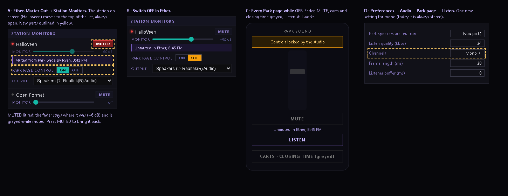

# Park sound — "URGENT fix" check against installer 17c3aac7 / ee2d98b (2026-10-13)

## Jeff's question (verbatim)

> Before I install: the URGENT fix isn't mentioned in this installer report. Is it in 17c3aac7 / ee2d98b? Answer in plain words for each:
> 1. Ether's MONITOR fader and MUTE always bring the park back after a Park page turned it down or muted.
> 2. The board shows Park page changes with who and when.
> 3. The "Park page control: ON/OFF" lock switch in Ether.
> 4. One level and one mute per station, no per-device state. Tested: mute from Park page A, log A out, unmute from Ether and separately from Park page B.
> If any of these is missing, build it now into this same installer before I install. That fix comes before Listen.

## Finding

The request never reached this session; the only mention of it in the session transcript is the message above. Nothing
of it was built. What the code in the installer actually does (source read; runtime UNVERIFIED unless stated):

- **How the Park fader works today** (`src/App.tsx` `ops:set-level` / `ops:set-mute`): it sets the station's own strip
  under **Station Monitors** (`monitor_volume`), NOT the big MONITOR fader in Master Out. MUTE = that strip at 0, with
  the level before it kept in `park_unmute_level`.
1. **Not met.** The big MONITOR fader multiplies with the station strip, so raising it does not bring the park back
   after a Park mute (0 × anything = 0). Ether has no MUTE button for the park at all; the strip only shows the word
   "MUTE" when it is at 0. Moving the station strip does bring it back, but:
2. **Not met.** The station strip reads its level only when the panel opens (`StationMonitorMixer.tsx` load effect), so
   after a Park page change Ether keeps showing the old level. Who/when is written on the server (`park_audit` table,
   `ether-backend` `parkAudit`) and shown nowhere: not in Ether, not on the Park page.
3. **Missing.** No such switch exists anywhere (searched `src`, `electron`, `ether-park/src`, `ether-backend/src`).
4. **Met in the code, never tested.** Level and mute live only in the station's `monitor_volume` / `park_unmute_level`;
   nothing is kept per device or per login. The A/B/log-out test has not been run.

## Waiting on Jeff before building

- Item 1: which Ether control must bring the park back (big MONITOR fader, the station's strip, or both), and where
  Ether's MUTE goes.
- Item 2: what "the board" means here and where the who/when shows.
- Item 3: what OFF locks (fader + MUTE only, or carts, closing time and Listen too) and where the switch sits.

## Jeff's decisions (verbatim)

> 1. The Park page fader and MUTE control HalloVeen's station fader (under Station Monitors), not the big MONITOR. That station fader must be clearly visible on the board, update live when the Park page changes it, and get its own real MUTE button. MUTE is a real mute that remembers the level (not "fader to 0"); unmuting from Ether or any Park page restores it. The big MONITOR stays the machine master.
> 2. Who and when ("Muted from Park page by Ryan, 8:42 PM") shows next to that station fader in Ether AND on the Park page.
> 3. "Park page control: ON/OFF" switch on HalloVeen's station fader strip in Ether. OFF locks fader, MUTE, carts and closing time on every Park page instantly ("Controls locked by the studio"). Listen stays allowed. Only Ether turns it back on. Show me a screenshot of its spot before building.
> 4. Run the test: mute from Park page A, log A out, unmute from Ether and separately from Park page B.
> Build all of this into the installer before Listen goes live, then give me the new path and sha256. Listen settings: I'll use 64 kbps, 20 ms, buffer 0.

Then: "Listen settings: 24 kbps mono, 20 ms frames, buffer 0. It's only for quick observing, so efficiency and least delay over quality."

## Mock for approval (nothing built yet)

Today (screenshot of this machine, 09:54): Station Monitors lists Open Format first; HalloVeen's strip is below it, out
of sight in Master Out. Proposed:
- A: the station on screen goes to the top of Station Monitors, always open. MUTE/MUTED button in the strip header; the
  fader keeps its position (greyed) while muted. Who/when line under the fader. "Park page control ON/OFF" under that.
- The who/when line shows the LAST change from anywhere, so an Ether change replaces "Muted from Park page by Ryan"
  with e.g. "Unmuted in Ether, 8:45 PM" (otherwise the line would describe a state that is no longer true).
- C: every Park page while OFF: "Controls locked by the studio", fader/MUTE/carts/closing time greyed, Listen works.
  The server refuses those writes too, and Ether refuses them itself.
- D: mono needs one new Listen setting, "Channels" (Mono/Stereo, no default) — the sender is always stereo today.

## Jeff (verbatim), after the mock

> Staff run the park from the Park page; only Jeff uses Ether. Any logged-in staff member on any Park page can adjust and undo any other staff member's fader or mute, and sees the who/when line on the Park page. Only the lock switch is Ether-only.

## Built (2026-10-13) — LOCAL, nothing pushed or deployed

Installer: `C:\openair\dist-electron\Ether Setup 4.6.59 parkcontrol+logo 2766c514 ce58ead.exe`
sha256 `2766c5142aaa8a2016f22e0bdcc2c46261deb764f8343b0c15e106ad751ff35d` — RELEASE GATE PASS (engine unchanged, 91b9f495).
Also carries the taskbar-logo fix (docs/ether-logo-everywhere-2026-10-13.md).

- Ether `5e633d7`: real MUTE (`monitor_muted`; main's `audio:setMonitorMute`; every path to the strip — Park page,
  Ether strip, Show Take, engine restore — holds it), who/when (`park_sound_last`, src/lib/parkSound.ts), the lock
  (`park_control` = off; Ether refuses `from_park` level/mute/closing/cart commands too), the station on screen first
  and always open, live updates (main's `ops:changed`), Listen Channels (Mono/Stereo, `park_listen_channels`).
  Built on the mock, plus: the strip keeps its level number next to MUTE (it was there before); the switch and
  who/when line are on every station's strip (each station can have a Park page).
- Server `db7cda1`: 423 "Controls locked by the studio" on level/mute/closing/fire; commands carry `from_park` and the
  staff name; GET shows `park.locked` and `park.last`, the name only to logged-in staff (read-only check, no writes on
  the 4 s refresh). Sits on `f7d720e` (Listen, inert until its Railway variables are set).
- Park page `115e274`: lock note + fader/MUTE/carts/closing greyed (Listen stays), who/when line under MUTE, refresh
  identifies the staff member. Sits on `1303a47` (Listen button).
- Tests: tsc 0 errors; leak guard 13; vitest 888/888 (new: MUTE holds through a restart); server 130/130.
- HalloVeen before install (read-only snapshot 10:0x): strip 0.82, not muted — nothing to carry over.

## Not yet done

- Test 4 (mute from Park page A, log A out, unmute from Ether and separately from Park page B) needs this build
  installed on OVEVENTS and the server + Park page deployed. Not run.
