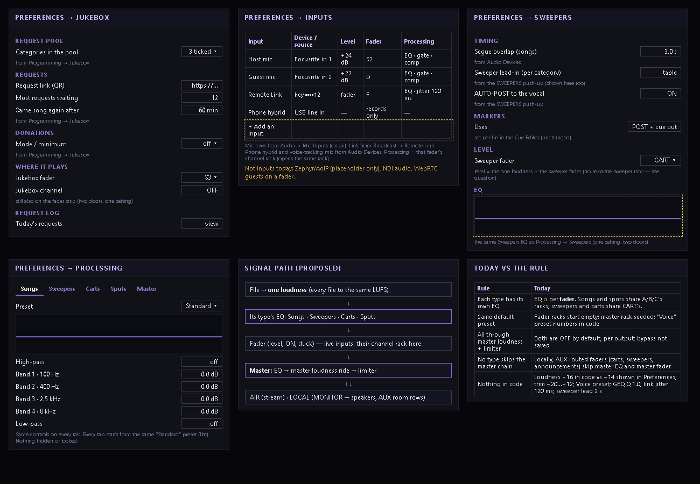

# Preferences: Jukebox, Inputs, Sweepers, Processing per type — PLAN ONLY (2026-10-13)

Nothing is built. Survey of the code done read-only (file:line receipts below are what the source says; runtime
behaviour is UNVERIFIED unless stated).

## Jeff (verbatim)

> Rule (replaces my earlier "all the same", which was misread): songs, sweepers, carts and spots each have their OWN EQ panel with its own settings. They all get equal treatment: every type starts from the same standard default preset, has the same set of controls, and nothing is locked or hidden. They all pass through the same master loudness and limiter chain before going to the local output and to air. No type skips the master chain, and no type has settings baked in code.
>
> Preferences, plan and mock only, build nothing until I approve:
> 1. A Jukebox page: first tell me in plain words what "jukebox" covers in Ether today and where its settings live now.
> 2. An Inputs page: every input source (mics, line-ins, the Focusrite, remote feeds) with device, level, which fader it goes to, and processing.
> 3. A Sweepers page: the overlap/segue timing, markers and level, plus its own EQ panel.
> 4. Songs, carts and spots each get their own EQ panel too, same layout as sweepers. Tell me where they fit (their own pages, or one Processing page with a tab per type).
> 5. Show the signal path in plain words: each type's EQ, then the master loudness and limiter, then local and air.
>
> Tell me what exists today versus this rule, and anything that breaks it. Screenshot mock of each page, and list which existing settings move where. Nothing removed or lost in the move.

## 1. What "jukebox" is today

A public request wall: guests pick songs from the station's chosen categories, on the fullscreen kiosk (☰ → Jukebox,
`src/components/Jukebox.tsx`) or from their phone via the QR link; requests pass one gate (`electron/main.js:7988-8130`)
and play on whichever source fader is set to the kind "jukebox" (D/E/F/S1–S5, `audiod/jukebox-decks.js:12`), through
that fader's ON switch (default off). It is not a playlist or clock (`jukebox_source_clock_id` is dead,
`SettingsPanel.tsx:1946`).

Where its settings live now:
| Setting | Stored | Edited |
|---|---|---|
| Pool categories | kv `jukebox_categories` | Preferences → Programming → Jukebox (`SettingsPanel.tsx:2106-2144`) |
| Request link (QR) | kv `jukebox_request_url` | same (`:2146-2160`) |
| Most waiting / repeat minutes | kv `jukebox_max_pending`, `jukebox_repeat_minutes` | same (`:2162-2185`) |
| Donations | server (`setJukeboxDonationSettings`) | same (`:2201-2337`) |
| Jukebox channel ON | kv `jukebox_channel_on` | the fader strip (`FaderSection.tsx:203-235`) |
| Which fader | `deck_configs` kind `jukebox` | deck configurator / strip source dropdown |
| Request log | local table `jukebox_requests` | (kiosk) |

## 2. Inputs today

| Input | Device | Level | Fader | Processing |
|---|---|---|---|---|
| On-air mic / interface (Focusrite) | Audio → Mic Inputs (on air) (`MicInputsSettings.tsx`) or the strip | input gain −10…+40 dB, kv `mic_input_<slot>` (machine-local) + the fader | D/E/F/S1–S5, kind `mic` | that fader's channel rack (HPF/LPF, 4-band EQ, gate, comp) |
| Remote Link | Broadcast → Remote Link; key on the strip | the fader (no input trim) | kind `link` | jitter buffer (120 ms default, `native/src/link.rs:35`) + channel rack |
| Phone hybrid | Audio Devices (browser) | — | none: records to a file | — |
| Voice-tracking mic | Audio Devices (browser) | — | not on air | — |
| Zephyr / AoIP | — | — | kind `network` is a placeholder ("Phase 2") | — |
| NDI audio, WebRTC guests on a fader | not found | | | |

## 3. Sweepers today

- Segue overlap (songs): kv `segue_overlap_sec`, Preferences → Audio Devices (`SettingsPanel.tsx:3205-3214`), default 3.
- Lead-in per music category (`categories.overlay_lead_in_sec`, default 2 in code, `SweepersPanel.tsx:41`), fallback
  pool, AUTO-POST: the SWEEPERS push-up (`SweepersPanel.tsx`).
- Markers: per file in the Cue Editor (cue in/out, POST = `intro_end_ms`, outro start).
- Level: no sweeper level of its own — the one loudness rule + the fader the sweeper plays on (CART or a sweeper slot).
- EQ: none of its own — whatever rack the CART / sweeper fader has.

## Today vs the rule — what breaks it

1. **EQ is per fader, not per type.** Channel racks are per slot (`rack_ch_<slot>`, `audiod/rack-seed.js:127-135`).
   Songs and spots both play on A/B/C, so they share those racks; sweepers and carts share CART's. No per-type
   processing exists (`audiod/loudness.js:3-13`).
2. **No common starting preset.** Fader racks start empty; the master rack is seeded from older settings
   (`rack-seed.js:47-91`); a "Voice" preset's numbers are in code (`channelRack.ts:126-139`).
3. **The master loudness ride and limiter are OFF by default**, per output (`audio.rs:927-928`); the stream chain runs
   only if "process stream" is on, the local one only if "process local output" is on; the bypass switches are not
   saved (`audio.rs:936-939`). With both off, no type passes the master loudness/limiter.
4. **Locally, AUX-routed faders skip the master chain.** Faders routed to AUX (S/D/E/F by default — carts, sweepers,
   announcements) go to the room without the master EQ and master fader; only an AUX processor, and only if "process
   local output" is on (`audio.rs:4607-4619, 5128-5190`). The room chain uses the old `proc_*` values, not the master
   rack's (`audio.rs:5021-5067`). To AIR every fader passes the master EQ + master fader (`audio.rs:4592`).
5. **Numbers in code:** loudness target default −16 LUFS (`board-state.js:199`) while Preferences → Loudness
   Normalization shows −14 (`SettingsPanel.tsx:3415`) — a conflict; trim clamp −20…+12 dB (`loudness.js:25`); "Voice"
   preset; GEQ Q 1.0 (`eq.rs:18`); comp RMS 5 ms, EQ crossfade 20 ms (`chdsp.rs:45`); link jitter 120 ms; sweeper lead
   2 s; mic gain range. (Full list: `docs/audio-numbers-audit-2026-10-11.md`.)

## Proposal

**Where the EQ panels go:** one **Processing** page with a tab per type — Songs · Sweepers · Carts · Spots · Master —
same layout on every tab (the channel rack's controls: high-pass, 4 bands, low-pass, and the dynamics the rack has),
every tab starting from one "Standard" preset (flat, all off), nothing hidden. Reason: the same controls five times is
one page with tabs, not five pages. The **Sweepers** page shows the Sweepers EQ too — the same setting, a second door.

**Signal path (proposed):**
1. File → one loudness (every file to the same LUFS — unchanged).
2. Its type's EQ (Songs / Sweepers / Carts / Spots) — NEW, follows the file onto whatever fader plays it.
3. The fader (level, ON, duck). Live inputs (mics, Remote Link) keep their channel rack here.
4. Master: EQ → loudness ride → limiter.
5. Then out to AIR and to LOCAL (MONITOR → speakers; AUX room rows) — local takes the same master loudness + limiter.

**Pages** (mock above): Jukebox (gathers the Programming → Jukebox settings + which fader + the channel switch), Inputs
(one table of every live input; processing opens that fader's rack), Sweepers (timing, markers, level, EQ), Processing.

### Settings that move — nothing removed

| Setting | Now | Moves to |
|---|---|---|
| Jukebox pool, request link, waiting/repeat limits, donations | Programming → Jukebox | Jukebox page |
| Jukebox fader / channel ON | strip only | Jukebox page **and** the strip |
| Mic inputs (device, channel, gain) | Audio → Mic Inputs (on air) | Inputs page |
| Remote Link (receive/send) | Broadcast → Remote Link | Inputs page (send settings stay in Broadcast too) |
| Phone hybrid input, voice-tracking mic | Audio Devices | Inputs page |
| Segue overlap | Audio Devices | Sweepers page |
| Sweeper lead-in per category, fallback pool, AUTO-POST | SWEEPERS push-up | stays there; shown on the Sweepers page too |
| Markers | Cue Editor | unchanged (Sweepers page explains them) |
| Master rack (EQ, ride, limiter, presets) | Master Out → Processor rack | Processing → Master tab (rack door stays) |
| Per-fader channel racks | strip EQ button | unchanged (live inputs; also opened from Inputs) |

## Questions for Jeff

1. **The SWEEPERS push-up is the one imaging home** (CLAUDE.md: "There is NO Settings→Programming jingles entry…
   this panel is the single home"). A Sweepers page in Preferences conflicts with that. OK to show the same settings
   in both, or should the Sweepers settings stay in the push-up only, with the EQ there?
2. **Type EQ and fader racks:** with type EQ, a song on fader A would get Songs EQ **and** fader A's rack. Keep fader
   racks for live inputs only (mics, links), or keep both?
3. **Announcements and jukebox songs** are types too. Their own tabs, or jukebox = Songs and announcements = Carts?
4. **Master loudness ride + limiter:** the rule says every type passes them. Today they are off by default and can
   be switched off per output. Always on, or keep the switches?
5. **Local AUX rows:** run them through the same master loudness + limiter (as the rule says)? The master fader stays
   air-only as today ("board = air, slot = room").
6. **Sweeper level:** a per-type level would break the one-loudness rule (`audiod/loudness.js`: "No per-type or
   per-item exceptions"). Keep level = loudness + fader, or add a per-type level?
7. **Loudness target:** code default −16 LUFS, Preferences text −14. Which is right?
